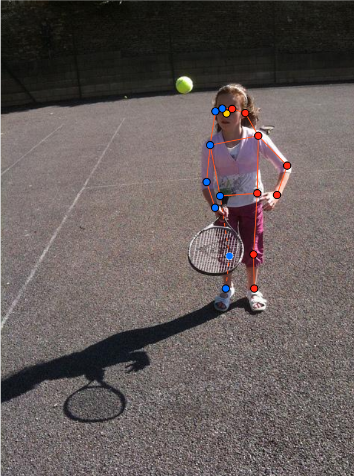
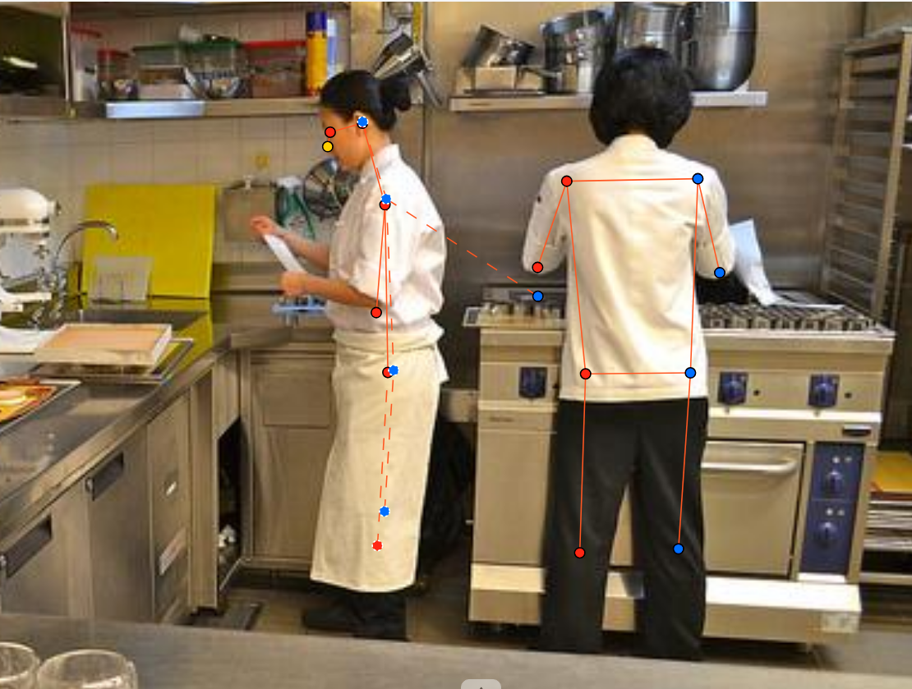
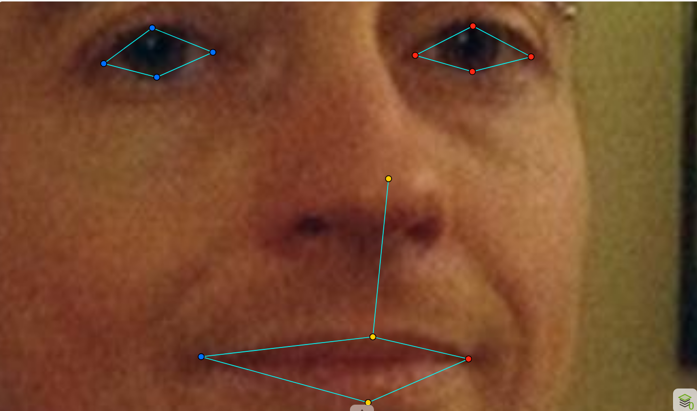
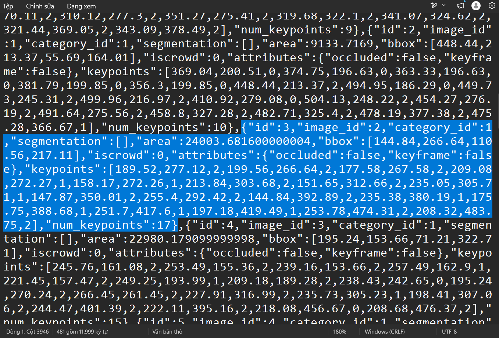

# Báo cáo cá nhân — HoVaTen-MSSV

Đổi tên file theo quy tắc `MSSV_HoTen.md`. Ví dụ: `20241234_NguyenVanAn.md`.

Dữ liệu: 12 ảnh người COCO val2017 (Lin et al., 2014) và 8 ảnh chân dung Wikimedia Commons, chỉ dùng trong lớp.

## 0. Thông tin học viên

- Họ tên: Khưu Minh Phú
- MSSV: 2A202603337
- Email: phukhuu39@gmail.com
- Link repository: https://github.com/kminhphu/K5-L2B-DAY04-KhuuMinhPhu-2A202603337-KeypointPose-Student
- Phiên bản CVAT (Help → About): 2.74.1
- Máy: hệ điều hành Windows · RAM 32 GB · chạy CVAT chế độ đầy đủ
- Bộ ảnh (`src/exports/assignment.json` do `lab.py setup` tạo): có 
- Giờ bắt đầu: 17h21p ngày 12/11/2026
- Giờ kết thúc:

## 1. Kiểm tra label (CP0)

| Label | Kiểu | Số điểm | Tên điểm đúng bảng của lab? | Đúng thứ tự? | Số cạnh |
|---|---|---:|---|---|---:|
| `person` |Skeleton người |17 |Đúng |Đúng |19 |
| `face` |Skeleton khuôn mặt |13 |Đúng |Đúng |13 |

Mẫu `person` dựng theo người quay mặt về camera (các điểm `left_*` nằm bên phải khung mẫu)? Có / Không
Trả lời: Có
Cách đổi cờ `occluded` / `outside` cho **một điểm** trên phiên bản CVAT này (một câu):
Chọn điểm, nếu occluded nhấn phím Q, outside thì nhấn phím O hoặc chuột phải vào điểm và chọn occluded hoặc outside

## 2. Số lượng đã gán và thời gian (CP1, CP2)

| Nhóm ảnh | Số ảnh | Số skeleton đã gán | Số người dưới 60 px (không gán) | Số poster / gương / màn hình bỏ qua | Thời gian (phút) |
|---|---:|---:|---:|---:|---:|
| `easy` | 5 | 5 | 0 | 0 | 25 |
| `occluded` | 3 | 3 | 6 | 0 | 7 |
| `back` | 2 | 4 | 0 | 0 | 8 |
| `small` | 1 | 2 | 5 | 1 | 7 |
| `crowd` | 1 | 3| 5| 0 | 12 |
| `faces` | 8 | 8 | — | 0 | 40 |

- Số ảnh người đã xong ở mốc phút 105: 8 / 10
- Thời gian thực tế (phút): CP1 120 · CP2 30 · CP3 20
- Ảnh tốn thời gian nhất là ảnh nào, vì sao?
Trả lời: Ảnh tốn thời gian nhất là ảnh 000000381889.jpg vì có nhiều đối tượng và có cả occluded và outside

## 3. Bảng ca khó (CP1, CP2)

Mỗi điểm bạn phân vân một dòng, nhất là phân vân giữa `v = 1` và `v = 0`, hoặc không chắc hướng người.

| Ảnh | Người / mặt | Điểm | Cờ đã chọn | Phân vân giữa | Lý do chọn |
|---|---|---|---:|---|---|
|face_99874.jpg |Mặt |1, 2, 3, 4, 5, 6, 7, 8 | v = 1 (occluded) |v = 1 và v = 0  |xem lại GUIDELINE.md |
|000000381889.jpg |Người |9, 10, 11, 12 | v = 0 (outside)|v = 1 và v = 0 |Bị khuất không thể đoán được |
|000000167027.jpg |Người |13 điểm |v = 0 (outside) |Gán và không gán |Người cao dưới 60 px |

## 4. Bảng tự review (CP3)

Đi từ ảnh cuối về ảnh đầu. 5 ảnh người (ít nhất 2 ảnh `back` hoặc `crowd`) và 3 ảnh mặt. Ít nhất 8 dòng, kể cả dòng `ok`. Ghi lỗi trước, sửa sau.

Mã lỗi dùng đúng một trong: `lr_swap`, `vis_flag`, `position`, `missing`, `extra`, `ok`.

| Ảnh | Người / mặt | Điểm | Mã lỗi | Ghi chú | Đã sửa? |
|---|---|---|---|---|---|
|000000580257.jpg |Người | |ok |Không có lỗi | |
|000000429594.jpg |Người | |ok |Không có lỗi | |
|000000381889.jpg |Người | |missing | Người cao trên 60px |Đã sửa |
|000000351176.jpg |Người | |ok |Không có lỗi | |
|000000324953.jpg |Người | |lr_swap |Người quay lưng |Đã sửa |
|face_99874.jpg |Mặt |1, 2, 3, 4, 5, 6, 7, 8 |vis_flag |Đeo kính râm |Đã sửa |
|face_556064.jpg |Mặt | |ok |Không có lỗi | |
|face_449454.jpg |Mặt | |ok |Không có lỗi | |

Tổng hợp số lỗi theo mã:

| `lr_swap` | `vis_flag` | `position` | `missing` | `extra` | `ok` |
|---:|---:|---:|---:|---:|---:|
| | | | | | |

Điểm còn phân vân giữa `v = 1` và `v = 0` (ghi cả hai lựa chọn và lý do chọn):

...

## 5. Kiểm file xuất và kết quả tự kiểm (CP4)

Tự kiểm tay trong file JSON:

| File | Người / mặt kiểm (ảnh, thứ tự) | Số phần tử `keypoints` | Điểm `outside` ra `v = 0`, `occluded` ra `v = 1`? | `num_keypoints` khớp? |
|---|---|---:|---|---|
| `KhuuMinhPhu_persons.zip` |Người |20 | | |
| `KhuuMinhPhu_faces.zip` |Mặt |8 | | |

Sau khi xuất, CVAT ghi `occluded` thành `v = ___` và `outside` thành `v = ___`. Tọa độ của điểm `outside` trong file là `0, 0` hay tọa độ cũ? ___

Hai job đã chuyển sang completed trên CVAT? Có / Không

Dán phần **TÓM TẮT** in ra từ `src/check_submission.py`:

```text
- File person: KhuuMinhPhu_persons.zip
  Số ảnh: 12 · số skeleton `person`: 20 · mỗi annotation 51 số
  Skeleton theo ảnh: 000000054909=2, 000000072098=1, 000000162046=1, 000000167027=2, 000000179201=2, 000000194027=1, 000000196283=1, 000000324953=2, 000000351176=2, 000000381889=3, 000000429594=1, 000000580257=2
  Cờ v: v=2 225 (66%) · v=1 35 (10%) · v=0 80 (24%)
  num_keypoints trung bình: 13.0
- File face: KhuuMinhPhu_faces.zip
  Số ảnh: 8 · số skeleton `face`: 8 · mỗi annotation 39 số
  Skeleton theo ảnh: face_125051=1, face_145751=1, face_185015=1, face_232598=1, face_333134=1, face_449454=1, face_556064=1, face_99874=1
  Cờ v: v=2 96 (92%) · v=1 8 (8%) · v=0 0 (0%)
  num_keypoints trung bình: 13.0
- Ghi chú: 80 điểm v = 0 vẫn mang tọa độ cũ (CVAT 2.x xuất như vậy; chuẩn COCO ghi 0, 0). Không phải lỗi: điểm v = 0 bị bỏ qua khi huấn luyện và khi chấm.
- Số [LỖI]: 0 · số [CẢNH BÁO]: 1
Kết quả: ĐẠT (đọc lại từng cảnh báo ở trên)
```

Các `[CẢNH BÁO]` còn giữ nguyên và lý do:

 [CẢNH BÁO] 000000580257.jpg #1: cặp ankle nằm ngược phía so với các cặp còn lại. Có thể đổi trái/phải một cặp (`lr_swap`), hoặc tay / chân bắt chéo thật: kiểm lại. Lý do giữ lại là do chân bắt chéo thật.

## 6. Ảnh chụp màn hình

1. Label `person` trong label constructor (đủ 17 điểm có tên):

   

2. Một người quay lưng đã gán, cờ đã đặt:

   

3. Một khuôn mặt đã gán 13 điểm, phóng to vùng mắt:

   

4. Một đoạn JSON xuất của một người:

   

Nguồn ảnh: COCO val2017 / Wikimedia Commons.

## 7. Tự đánh giá

1. Lỗi bạn mắc nhiều nhất hôm nay, và cách bạn sẽ tránh ở dự án thật:

   

2. Một quy tắc bạn đề xuất thêm vào guideline (kèm ảnh ví dụ nếu có):

   Không có

3. Nhãn của bạn đi vào model ở đâu? Chọn một lỗi bạn đã sửa và nói nó sẽ làm model học sai thế nào (heatmap, trọng số trong loss, hay bước lật ảnh):

   ...

## 8. Khó khăn và lỗi kỹ thuật


## Bonus (nếu làm)

### B1 — 3 ảnh người khó thêm

| Ảnh | Số skeleton | Số người dưới 60 px | Ca khó nhất |
|---|---:|---:|---|
| | | | |
| | | | |
| | | | |

Kết quả `src/check_submission.py` cho `HoVaTen_bonus_persons.zip`:

```text
(dán ở đây)
```

### B2 — 5 ảnh khuôn mặt đen trắng / hồng ngoại

Ảnh không màu khó hơn ở điểm nào? Kính râm trên ảnh hồng ngoại có còn là `v = 1` không?

...

### B3 — Model so với nhãn của tôi (không tính điểm)

- Demo đã dùng:
- Ảnh đã thử:

1. Model có trả điểm cho khớp bị che, hay khớp ngoài ảnh không? Confidence ở các điểm đó thế nào?

   ...

2. Với người quay lưng, model có đổi trái/phải không?

   ...

3. Bộ điểm của model có giống 17 điểm COCO không?

   ...

## 9. Tài liệu tham khảo và công cụ AI đã dùng
Công cụ AI đã dùng: Gemini - hỗ trợ giải thích thuật ngữ và trong lúc viết báo cáo.
